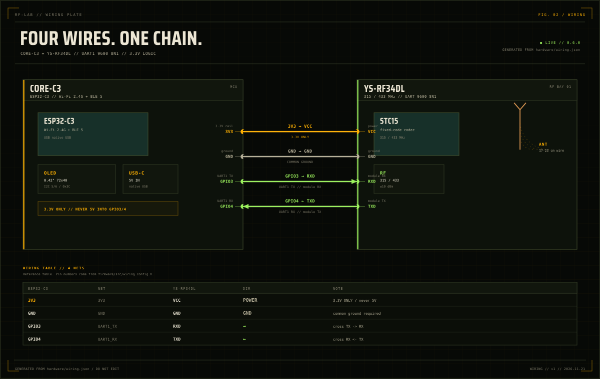
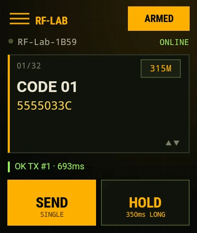
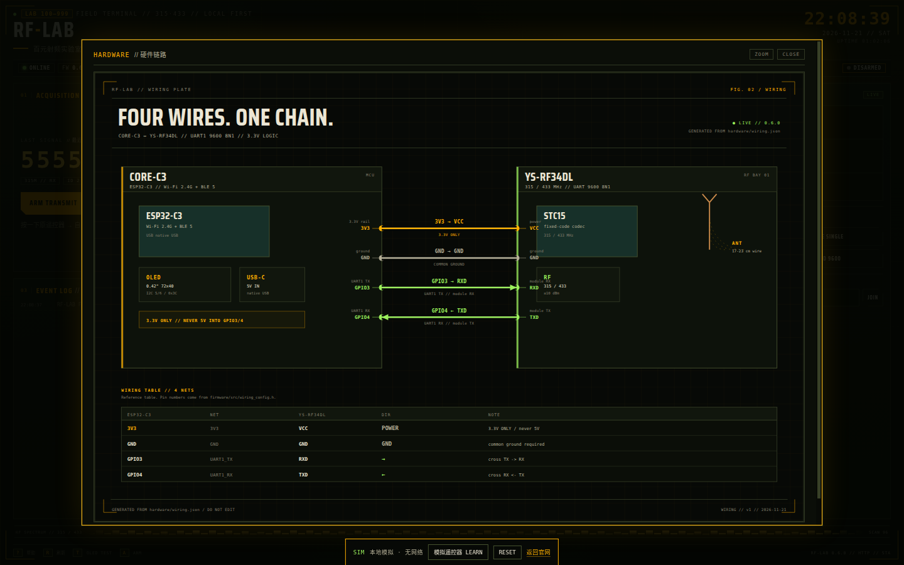
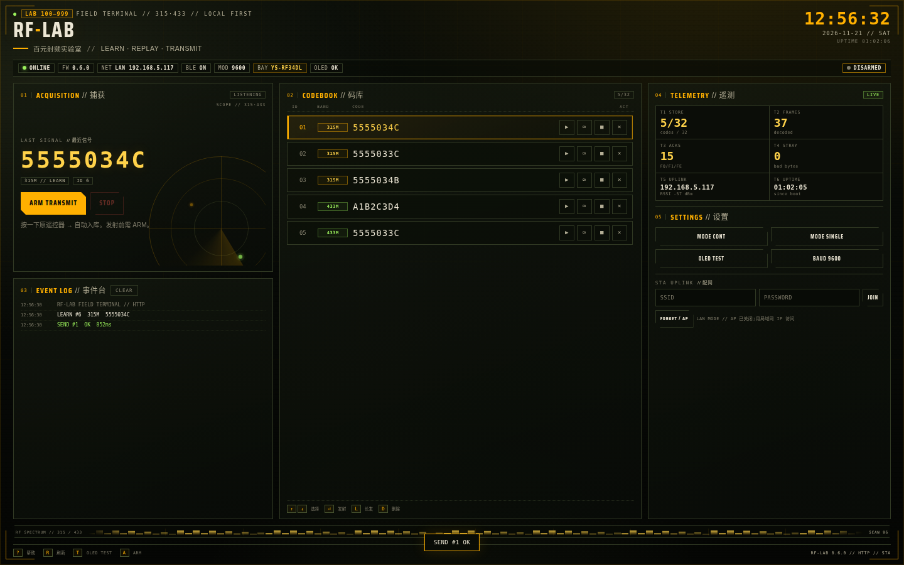
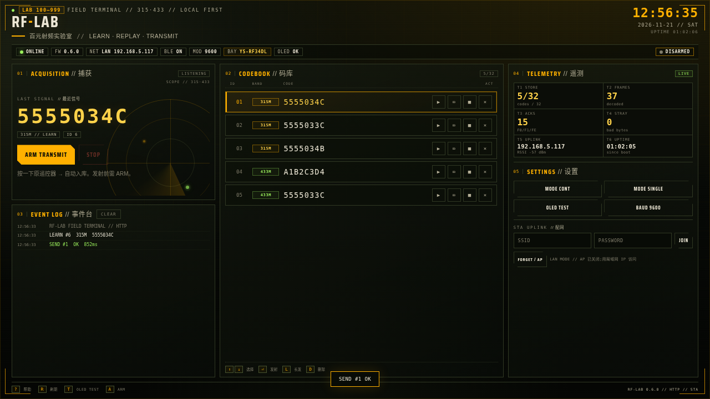
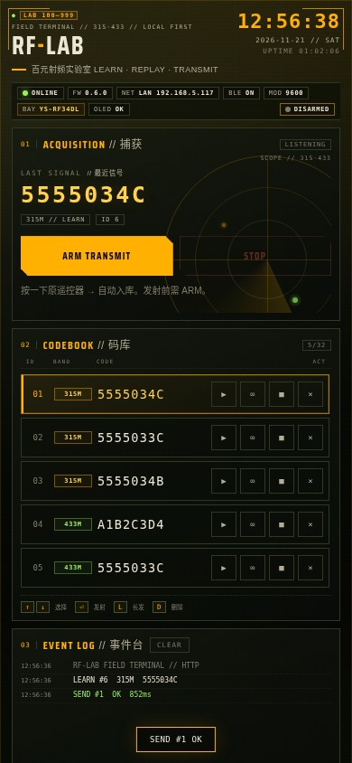
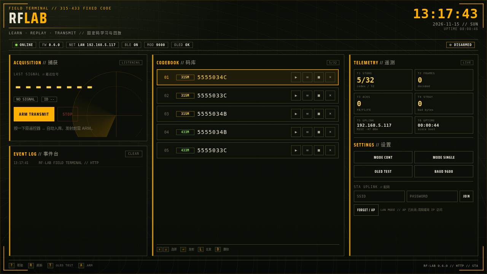

# RF-LAB · 百元射频实验室

**丰俭由人:¥100 的固定码侦察包 → ¥999 的全频段工作台。**
一块 ESP32-C3,五个可换射频舱位;同一套命令契约延伸到 **Web / Android / uConsole /
OPPO Watch 2**,与官网共用一套视觉基线([`docs/01-ui.md` §5.1](docs/01-ui.md))。
现役链路是 **YS-RF34DL 315/433 固定码**;CC1101 / NRF24L01 / SI4463 / LR1121、
MQTT 与 Home Assistant 是路线图,不是现货能力。

[**官网 / 配装台(线上)**](https://heiheiheiheiheihei.github.io/rf-lab/) · [**下载 Android APK**](https://github.com/heiheiheiheiheihei/rf-lab/releases/latest/download/rf-lab-android.apk) · [**OPPO Watch 2 客户端**](watch/README.md) · [**下载 Watch APK**](https://github.com/heiheiheiheiheihei/rf-lab/releases/download/watch-v0.1.0/rf-lab-watch.apk) · [本地源](site/index.html) · [射频规格](docs/00-mvp.md) · [UI 规格](docs/01-ui.md) · [接线](hardware/README.md) · [官网维护说明](site/README.md)


## ¥100 → ¥999:先买一块能用的板

| 档位 | 预算 | 组成 | 能力 |
|---|---:|---|---|
| 侦察兵 SCOUT | ¥100 | CORE-C3 + YS-RF34DL | 315/433 固定码学习 / 回放(**现役,已上机**) |
| 突击手 ASSAULT | ¥299 | + CC1101 + NRF24L01 + 背板 + 天线包 | Sub-GHz + 2.4G(路线图) |
| 战术组 TACTICAL | ¥599 | + SI4463 + LR1121 + 收纳盒 | 全频段雏形(路线图) |
| 全频段 ALL-IN | ¥999 | 全模块 + FIELD DOCK | 全舱位 / 现场终端(路线图) |

> 价格为**参考物料价**,不含运费与工具;路线图模块未接入 0.7.1 固件,不能下单即用。
> 交互式配装器:[`site/index.html`](site/index.html);预算/边界/发布说明:[`site/README.md`](site/README.md)。

### 射频模块

| 模块 | 频段 | 接口 | 角色 | 状态 |
|---|---|---|---|---|
| **YS-RF34DL** | 315 / 433 MHz | UART 9600 | 固定码学习 / 回放 | ✅ **现役,上机验证** |
| CC1101 | 300–928 MHz | SPI | Sub-GHz 通用收发 | ○ 路线图,未接入 |
| NRF24L01+ | 2.4 GHz | SPI | 2.4G 私有链路 | ○ 路线图,未接入 |
| SI4463 | 119–1050 MHz | SPI | 远距 / 窄带 | ○ 路线图,未接入 |
| LR1121 | Sub-GHz + 2.4G | SPI | 双频 LoRa / (G)FSK | ○ 路线图,未接入 |

> 配装器可以勾选路线图模块,那是**采购与规划**,不是固件能力。只有 YS-RF34DL 做过上机验证。

## 现役链路

两块板:**ESP32-C3 OLED** + **YS-RF34DL** 315/433 编解码模块。
按一下原遥控器 → 模块解码 → ESP32 存码 → 板载 OLED 显示状态 → **Web / BLE / 串口 / uConsole**
发射 → 原接收器动作。



硬件视觉是**抽象接线图**,不画 3D/PCB:只保留两块功能块、4 根线和必须正确的引脚。
唯一源是 [`hardware/wiring.json`](hardware/wiring.json);`tools/gen_wiring.py` 同时生成
`firmware/src/wiring_config.h`、`hardware/README.md` / `docs/00-mvp.md` 的接线表和
4 张 SVG,`gen_wiring.py --check` 在主机测试与固件构建前校验一致性。
官网 §01 用宽图(窄屏切竖图)、§02 放主控/模块引脚图;设备 UI 顶栏 `HW` 芯片(或按 `H`)
打开同一张图,`ZOOM/FIT` 缩放。
**3.3V ONLY**、共地、`GPIO3→RXD` / `GPIO4←TXD` 由接线表保证;图不是比例图,
引脚/供电仍以 [`hardware/README.md`](hardware/README.md) 为准。参考照片不入库。

同一块 C3 现在同时提供:

| 入口 | 形态 | 说明 |
|---|---|---|
| **Web** | LAN IP(STA)或 `http://192.168.4.1/`(AP 回退) | 板载 HTTP + SSE,手机/PC/uConsole 浏览器直接用 |
| **Android** | BLE APK | 同一份单页 UI 跑在 WebView,原生 BLE 桥 |
| **OPPO Watch 2** | 独立 BLE APK | 402×476 单屏;ARM → SEND;按住 HOLD → LONG,松手 STOP;46mm 真机已验证 |
| **uConsole** | 键盘 TUI | `rflab-tui`,HTTP 优先、USB 串口回退,琥珀/橄榄战术风 |
| **串口** | `tools/rf34dl.py` | 0.5.0 既有命令行,行为不变 |

### 手腕上的发射键

OPPO Watch 2 客户端把手机端的「选码 → ARM → SEND」压缩成一屏:码卡上下滑换码,
`SEND` 单发,`HOLD` 按住 350ms 才发 `LONG`、松手立刻 `STOP`;断链/退后台先停。
它只走 BLE,复用同一套 GATT/行协议,**不改固件、不改手机 APP**。



- 46mm `OW20W1` / Android 8.1 (API 27) / 402×476 @320dpi 真机已验证:安装、扫描、
  PIN、32 码、ARM/SEND、HOLD/LONG/STOP、错误 PIN、退后台 STOP、OLED TEST。
- 独立 **release key** 签名(不与手机 APK 共用);debug → release 需卸载后重装。
- 公开 Release:[**下载 rf-lab-watch.apk**](https://github.com/heiheiheiheiheihei/rf-lab/releases/download/watch-v0.1.0/rf-lab-watch.apk) ·
  [`SHA256SUMS.txt`](https://github.com/heiheiheiheiheihei/rf-lab/releases/download/watch-v0.1.0/SHA256SUMS.txt)
- 规格与安装:[`watch/README.md`](watch/README.md) · 证据:[`docs/evidence/2026-11-22-watch-release.md`](docs/evidence/2026-11-22-watch-release.md)

**Wi-Fi 模式**:有凭据先 `STA-only` 接局域网(AP 关闭);15s 连不上自动打开 AP 回退;
AP 下可以直接用,也可以重新配网或 `WIFI CLEAR`。AP 里配网成功会保持 AP,避免踢掉
正在配网的浏览器;下次启动再回到 STA-only。

- **射频/命令唯一规格**:[`docs/00-mvp.md`](docs/00-mvp.md)
- **跨平台 UI 规格**:[`docs/01-ui.md`](docs/01-ui.md)
- **接线**:[`hardware/README.md`](hardware/README.md)(模块 4 根线;引脚权威)
- **固件**:[`firmware/README.md`](firmware/README.md)(ESP-IDF 5.5.5 / ESP32-C3)
- **Android**:[`android/README.md`](android/README.md) · **uConsole**:[`uconsole/README.md`](uconsole/README.md) · **Watch**:[`watch/README.md`](watch/README.md)

## 官网 / 配装台

线上:<https://heiheiheiheiheihei.github.io/rf-lab/>(GitHub Pages / GitHub Actions 发布 `site/`)。

[`site/index.html`](site/index.html) 是静态单页:4 档预算、9 个模块勾选、实时配装单、
**内嵌真实单页 UI 的交互终端 demo**、OPPO Watch 2 实机区、MQTT/HA 路线图。
无站点构建、无外部字体、无 CDN、无外部/API 请求。

§03 终端区直接跑 `web/` 的真实 UI(iframe):可以 ARM、SEND、LONG、STOP、ERASE,也可以用
「模拟遥控器」学习一条新码;`site/assets/terminal-demo.js` 在 iframe 内接管
`fetch`/`EventSource`,本地回放 `/api/*` 与 SSE,只标 `SIM`,不发网络请求、不代表真机在线。


```bash
python3 tools/gen_wiring.py --check    # JSON -> 代码头/表/SVG 一致性
python3 tools/build_web.py             # 同步生成 site/assets/terminal.html
python3 -m http.server 8088 -d site    # http://127.0.0.1:8088/
python3 tools/site_check.py            # 静态验收(含 demo 资源)
node --check site/app.js
node --check site/assets/terminal-demo.js
```

## 快速开始

```bash
export PATH="$HOME/.platformio/penv/bin:$PATH"

# 1) 构建 + 烧录(必须用 flash.sh:它会一起写 2MB 分区表)
./tools/flash.sh /dev/ttyACM0

# 2) Web:
#    有 STA 凭据:设备先连局域网;成功用串口 INFO / OLED 显示的 LAN IP 访问。
#    无凭据或 15s 连不上:连 AP "RF-Lab-XXXX" / 密码 rflab1234,打开 http://192.168.4.1/
#    AP 设置页填 SSID/PASSWORD 配网;FORGET/AP 清除凭据。
#    串口会打印 AP SSID/IP、BLE PIN;OLED 开机页也显示 PIN / LAN / AP 状态。

# 3) 串口交互(既有)
python3 tools/rf34dl.py --port /dev/ttyACM0
python3 tools/rf34dl.py --port /dev/ttyACM0 learn 15
python3 tools/rf34dl.py --port /dev/ttyACM0 send 1

# 4) uConsole 键盘 TUI
./uconsole/install.sh
rflab-tui --url http://192.168.4.1   # 若已接 LAN,换成 INFO/OLED 的 LAN IP

# 5) Android(已装 JDK/SDK/Gradle 时)
python3 tools/build_web.py
cd android && ./gradlew assembleDebug

# 6) OPPO Watch 2(独立 release key,见 watch/README.md)
set -a; . "$HOME/.config/rf-lab/watch-keystore.env"; set +a
./watch/check.sh
cd watch && ../android/gradlew assembleRelease
# android/app/build/outputs/apk/debug/app-debug.apk
```

主机单测:`./tools/host_test.sh`(协议 76 + 码库 368 + 事件环 9427 + OTA 41 + OLED/UI 1286 + TUI 12)。
APP 自更新逻辑主机测试:`./tools/app_update_test.sh`(版本比较 + `SHA256SUMS` 查表,36 checks)。
Wi-Fi 回退上机自检:`python3 tools/wifi_selftest.py --port /dev/ttyACM0`(15 项)。

## 状态

| 项 | 状态 |
|---|---|
| 构建(ESP32-C3,0.7.1) | ✅ 主机;Flash 1,098,608B / 2,031,616B OTA 槽;RAM 73,540B(2026-11-21,码库 v2) |
| 主机单测(协议 76 + 码库 368 + 事件环 9427 + OTA 41 + OLED/UI 1286 + TUI 12) | ✅ 主机 |
| 上机:学码 / 存码 / 改波特率 | ✅ 2026-11-15(0.5.0 证据) |
| 上机:发射 `SEND/LONG/STOP` | ⚠️ 2026-11-15 有 `F0/FE/FF`;2026-11-21 模块命令方向 0 应答;2026-11-22 `MODE` 已回 `F2`,但 **`SEND` 未复测** |
| 上机:Web HTTP/SSE/命令 | ✅ 2026-11-15,设备内 `WEBTEST` hello/state/events 200 + POST 202 |
| 上机:Wi-Fi STA 接 LAN | ✅ **真实** `SSID-A` → `192.168.5.117`;主机 ping/HTTP/SSE/POST 全通;STA 模式基础自检 18/18 |
| 上机:Wi-Fi AP 回退 | ✅ 15/15:有凭据 STA-only 启动(AP 关)→15s 超时 AP 回退 |
| 上机:真实浏览器 | ✅ Chromium 打开 `http://192.168.5.117/`,200,`NET LAN`,无 console error |
| 上机:重启 AP 关闭 | ✅ `mode=sta ap_on=0`,LAN 仍可访问 |
| 上机:AP 内配网 / CLEAR | ✅ 设备内;WebTest 经 AP 200,`WIFI CLEAR` 回 AP |
| 上机:BLE 广播 | ✅ `INFO` `adv=yes`;✅ **真机 BLE 连接/鉴权/命令回显/码表 9 条/状态栏刷新**(2026-11-21);⏳ BLE `SEND`、nRF 逐帧抓包未做 |
| Android APK | ✅ **0.7.1 已发** [Release](https://github.com/heiheiheiheiheihei/rf-lab/releases/tag/v0.7.1);CI 1,050,176B/versionCode 3/release 签名 v2;✅ 真机安装/自更新(2026-11-22);0.7.1 APK 的 BLE 码库写入 ✅;⏳ BLE `SEND` |
| APP 自更新(2026-11-21) | ✅ 查 Release + 一键更新/忽略此版本 + SHA-256/签名自检 + 系统安装器;主机 36 checks + 真实 Release 资产校验;✅ v0.7.0/v0.7.1 已发布;✅ **真机弹窗/下载/系统安装器/覆盖安装**(2026-11-22) |
| BLE 下行分帧(0.7.1) | ✅ 构建 + 主机 9418 checks;✅ **手机 BLE 端到端**(0 条 JSON 警告、命令回显、状态栏/码表刷新);⏳ nRF 逐帧 `0A` 未抓包;证据 [`2026-11-21-ble-framing.md`](docs/evidence/2026-11-21-ble-framing.md) |
| 码库 v2(0.7.1) | ✅ 真机 9 条码 OTA 迁移(`LIST` 逐字节一致)、UTF-8 名称/分组/符号、手工新建、编辑 band/code、删除、重启保留;✅ Web 1440/390 + APK 0.7.1 发布;✅ **BLE NAME/GROUP/SYM/EDIT 写入**(2026-11-22);证据 [`2026-11-21-codebook.md`](docs/evidence/2026-11-21-codebook.md) · [`2026-11-22-app-ble.md`](docs/evidence/2026-11-22-app-ble.md) |
| uConsole TUI | ✅ 主机解析/键位/PTY 布局;⏳ 真机未测 |
| Web UI refresh(2026-11-16) | ✅ 构建 + mock 布局;gzip 15,503B;⏳ 新皮肤未上机 |
| Web/固件 UI 视觉统一(2026-11-21) | ✅ 构建 + 主机 + mock 布局(1440/1280/390);gzip 16,745B;固件 1,069,052B;⏳ 全量皮肤/硬件模态待回归(0.7.1 码库页已真机截图) |
| 上机:双槽 OTA(2026-11-21) | ✅ A→B→A→final 三次 OTA(ui 62111123);错 token 401、坏镜像拒绝、中途断流仍运行旧槽;NVS 9 条码/Wi-Fi 保留;Web `U` 面板构建;⏳ **浏览器上传未回归** |
| UI 一键固件更新(0.7.3 规划) | ○ **未实现**;已定 **BOOT 确认 + GitHub Pages 固件源 + 独立 0.7.3 发版**;浏览器查 manifest → 下载/设备 SHA-256/上传;APP/BLE 不支持;见 [`docs/01-ui.md`](docs/01-ui.md) §3.4.1 |
| 官网 / 配装台(静态 + 交互 demo) | ✅ 2026-11-21 主机 Chromium 1440×1250 / 390×844,无 console error;`site_check.py` 通过;iframe 零 `/api`、零外部请求 |
| 官网交互式终端(2026-11-21) | ✅ 本地 Chromium:ARM/SEND/LONG/STOP/LEARN/RESET + 三视口;21/21 + 移动 12/12;iframe 零 `/api`、零外部请求;**✅ Pages 已部署**(资源 200);⏳ 线上交互未回归 |
| 官网线上(GitHub Pages) | ✅ 2026-11-21 已部署交互 demo;<https://heiheiheiheiheihei.github.io/rf-lab/>;`terminal.html` / `terminal-demo.js` 均 200 |
| 官网 APK 下载入口 | ✅ 导航 / 首屏 / 页脚指向 `releases/latest/download/rf-lab-android.apk`;⏳ 真机下载安装未测 |
| 路线图:MQTT / HA / 多模块 | ○ **未实现**,接口草案见官网 §04 |
| 上机:距离 / 长发时接收器是否真持续 | ⏳ 未测,见规格 §7 |
| 上机证据 | [`2026-11-22-firmware-flash.md`](docs/evidence/2026-11-22-firmware-flash.md) · [`2026-11-22-device-audit.md`](docs/evidence/2026-11-22-device-audit.md) · [`2026-11-22-app-ble.md`](docs/evidence/2026-11-22-app-ble.md) · [`2026-11-21-codebook-release.md`](docs/evidence/2026-11-21-codebook-release.md) · [`2026-11-21-codebook.md`](docs/evidence/2026-11-21-codebook.md) · [`2026-11-21-app-update.md`](docs/evidence/2026-11-21-app-update.md) · [`2026-11-21-ota.md`](docs/evidence/2026-11-21-ota.md) · [`2026-11-21-android-release.md`](docs/evidence/2026-11-21-android-release.md) · [`2026-11-15-bringup.md`](docs/evidence/2026-11-15-bringup.md) · [`2026-11-15-oled.md`](docs/evidence/2026-11-15-oled.md) · [`2026-11-15-ui.md`](docs/evidence/2026-11-15-ui.md) · [`2026-11-15-wifi.md`](docs/evidence/2026-11-15-wifi.md) · [`2026-11-15-wifi-lan.md`](docs/evidence/2026-11-15-wifi-lan.md) |

> ⚠️ **当前待复测(2026-11-22)**:设备已用 `tools/flash.sh` 重烧为 master HEAD
> **`build=dd71bf6`**(非 `v0.7.1` tag,见 [`2026-11-22-firmware-flash.md`](docs/evidence/2026-11-22-firmware-flash.md)),
> 码库 13 条(含 4 条 433M 幻码);UART `MODE` 已回 `F2`,但空口 `SEND` 未复测。
> 完整测试登记、优先级与 0.7.2 退出条件见 [`docs/02-plan.md`](docs/02-plan.md)。

## 范围

| 做 | 不做 |
|---|---|
| 315/433 固定码学习 / 解码 / 存 / 发 | 滚动码克隆 / 重放 |
| 单次发射、长发 / 停止 | 原始 OOK 波形记录 |
| 码库命名/分组/手工建码/改 band+4B code | 协议位解析 / 模块 TX 时长编辑 / `.sub` 导入 |
| 改模块波特率 / 输出模式 | 扫频 / RSSI / 频谱 |
| Wi-Fi STA 接 LAN + AP 回退(HTTP + SSE) | 公网/云账户 |
| 双槽 OTA(Web/串口,整包含页面) | BLE 上传固件 / 云推送 / 固件签名校验 |
| APP 自更新(GitHub Release,一键/忽略) | 静默安装 / 应用商店分发 |
| BLE 外设 + Android APP | BLE 链路加密(只有应用层 PIN) |
| uConsole 键盘 TUI | OLED 菜单/按键交互 |
| 串口 / OLED 状态页(既有,保留) | OLED 中文/图形界面 |
| 官网 / ¥100–999 配装规划(静态) | 把配装器里的路线图模块写成已支持 |
| 自有固定码设备的复制验证 | 对未知设备的"安全"断言 |

> ⚠️ 固定码本身可被复制:测试只对**自有**设备做,结论只对固定码成立。
> Web 的 `ARM` 只防误触,不是发射硬门控;**HTTP 无登录,AP 密码/局域网可达性是门槛**;
> BLE 只有 4 位应用层 PIN,不是强安全边界。

## 路线图(未实现)

| 版本 | 目标 | 状态 |
|---|---|---|
| 0.7.1 | 码库 v2:名称/符号/单分组/原始参数编辑/手工建码 | ✅ 实现 + 真机验证 + **已发版** |
| 0.7.2 | 验证闭合:测试工具/CI、空口/BLE/OTA 失败路径、发布可追溯 | ○ 计划,见 [`docs/02-plan.md`](docs/02-plan.md) |
| 0.7.3 | UI 一键固件更新:查 Pages manifest、BOOT 确认、下载/校验/上传 | ○ 规划,见 [`docs/01-ui.md`](docs/01-ui.md) §3.4.1 |
| 0.8.0 | 模块抽象层 + SPI 背板;CC1101 首发,NRF24/SI4463/LR1121 分批(0.8.x) | ○ 设计目标 |
| 0.9.0 | 本地 MQTT bridge + Home Assistant Discovery | ○ 设计目标 |
| 1.0 | 多模块外壳 / 小批量 | ○ 设计目标 |

> 官网 §04 的 MQTT / HA 拓扑与 topic 是**接口草案**,不是可售能力。
> 现在只有 HTTP/SSE + BLE/串口;不要提前写“支持 Home Assistant”。
> **测试债务、优先级、0.7.2/0.8.0 退出条件与执行顺序见 [`docs/02-plan.md`](docs/02-plan.md);
> 新会话交接见 [`docs/03-execution.md`](docs/03-execution.md)。**

## UI 截图

官网 §03 的交互终端(真实单页 UI,传输为本地模拟;点开即可操作):


设备 UI 的硬件模态(本地 Chromium,非上机截图):



## 设备端布局(mock 证据)

官网不再使用下面的截图;保留作设备端布局对照(不是上机截图,新皮肤未烧录):





真实设备 LAN 页面(0.6.0 旧皮肤,`192.168.5.117`,非 mock)仍保留作为上机证据:



真实 LAN 页面:[`ui-lan-live.png`](docs/evidence/ui-lan-live.png)(设备 `192.168.5.117`,非 mock)。
新皮肤构建/布局/未验证项:[`2026-11-21-ui-unify.md`](docs/evidence/2026-11-21-ui-unify.md)(上一版:[`2026-11-16-ui-refresh.md`](docs/evidence/2026-11-16-ui-refresh.md))。
官网交互 demo:[`2026-11-21-site-live-demo.md`](docs/evidence/2026-11-21-site-live-demo.md) ·
接线图/硬件效果图:[`2026-11-21-wiring-diagram.md`](docs/evidence/2026-11-21-wiring-diagram.md)。

上机细节与取舍:[`docs/01-ui.md`](docs/01-ui.md) · [`docs/evidence/2026-11-15-ui.md`](docs/evidence/2026-11-15-ui.md) · [`docs/evidence/2026-11-15-wifi.md`](docs/evidence/2026-11-15-wifi.md) · [`docs/evidence/2026-11-15-wifi-lan.md`](docs/evidence/2026-11-15-wifi-lan.md)。
