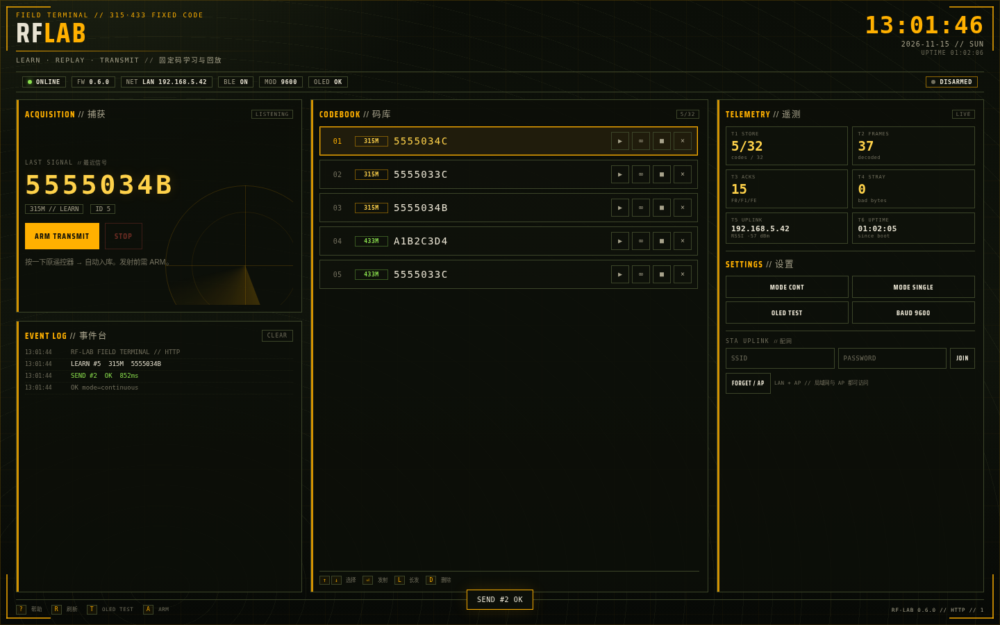
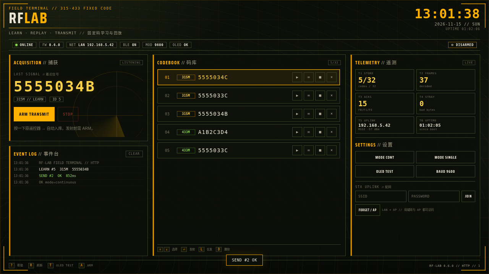
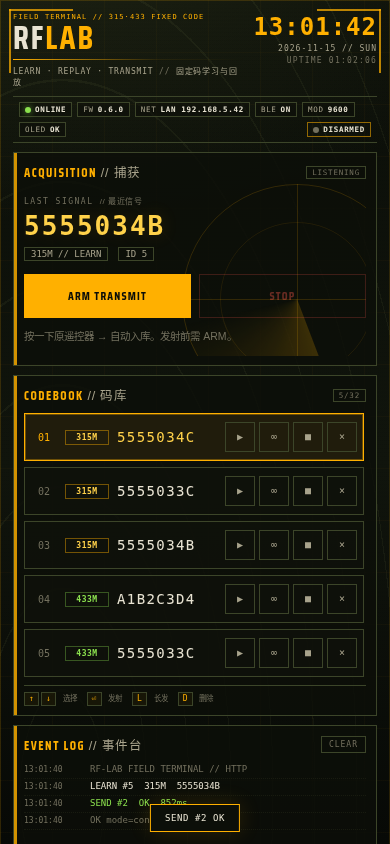

# RF-Lab · 315/433 固定码遥控 学习 / 复制 / 发射

两块板:**ESP32-C3 OLED** + **YS-RF34DL** 315/433 编解码模块。
按一下原遥控器 → 模块解码 → ESP32 存码 → 板载 OLED 显示状态 → **Web / BLE / 串口 / uConsole**
发射 → 原接收器动作。

同一块 C3 现在同时提供:

| 入口 | 形态 | 说明 |
|---|---|---|
| **Web** | LAN IP(STA)或 `http://192.168.4.1/`(AP 回退) | 板载 HTTP + SSE,手机/PC/uConsole 浏览器直接用 |
| **Android** | BLE APK | 同一份单页 UI 跑在 WebView,原生 BLE 桥 |
| **uConsole** | 键盘 TUI | `rflab-tui`,HTTP 优先、USB 串口回退,琥珀/橄榄战术风 |
| **串口** | `tools/rf34dl.py` | 0.5.0 既有命令行,行为不变 |

**Wi-Fi 模式**:有凭据先 `STA-only` 接局域网(AP 关闭);15s 连不上自动打开 AP 回退;
AP 下可以直接用,也可以重新配网或 `WIFI CLEAR`。AP 里配网成功会保持 AP,避免踢掉
正在配网的浏览器;下次启动再回到 STA-only。

- **射频/命令唯一规格**:[`docs/00-mvp.md`](docs/00-mvp.md)
- **跨平台 UI 规格**:[`docs/01-ui.md`](docs/01-ui.md)
- **接线**:[`hardware/README.md`](hardware/README.md)(模块 4 根线;引脚权威)
- **固件**:[`firmware/README.md`](firmware/README.md)(ESP-IDF 5.5.5 / ESP32-C3)
- **Android**:[`android/README.md`](android/README.md) · **uConsole**:[`uconsole/README.md`](uconsole/README.md)

## 快速开始

```bash
export PATH="$HOME/.platformio/penv/bin:$PATH"

# 1) 构建 + 烧录(必须用 flash.sh:它会一起写 2MB 分区表)
./tools/flash.sh /dev/ttyACM0

# 2) Web:
#    有 STA 凭据:设备先连局域网;成功用串口 INFO / OLED 显示的 LAN IP 访问。
#    无凭据或 15s 连不上:连 AP "RF-Lab-XXXX" / 密码 rflab1234,打开 http://192.168.4.1/
#    AP 设置页填 SSID/PASSWORD 配网;FORGET/AP 清除凭据。
#    串口会打印 AP SSID/IP、BLE PIN;OLED 开机页也显示 PIN / LAN / AP 状态。

# 3) 串口交互(既有)
python3 tools/rf34dl.py --port /dev/ttyACM0
python3 tools/rf34dl.py --port /dev/ttyACM0 learn 15
python3 tools/rf34dl.py --port /dev/ttyACM0 send 1

# 4) uConsole 键盘 TUI
./uconsole/install.sh
rflab-tui --url http://192.168.4.1   # 若已接 LAN,换成 INFO/OLED 的 LAN IP

# 5) Android(已装 JDK/SDK/Gradle 时)
python3 tools/build_web.py
cd android && ./gradlew assembleDebug
# android/app/build/outputs/apk/debug/app-debug.apk
```

主机单测:`./tools/host_test.sh`(协议 76 + 事件环 53 + OLED/UI 1286 + TUI 12)。
Wi-Fi 回退上机自检:`python3 tools/wifi_selftest.py --port /dev/ttyACM0`(15 项)。

## 状态

| 项 | 状态 |
|---|---|
| 构建(ESP32-C3,0.6.0) | ✅ 主机;Flash 1,066,628B / RAM 55,732B |
| 主机单测(协议 76 + 事件环 53 + OLED/UI 1286 + TUI 12) | ✅ 主机 |
| 上机:学码 / 存码 / 发射 / 改波特率 | ✅ 2026-11-15(0.5.0 证据仍有效) |
| 上机:Web HTTP/SSE/命令 | ✅ 2026-11-15,设备内 `WEBTEST` hello/state/events 200 + POST 202 |
| 上机:Wi-Fi STA 接 LAN | ✅ **真实** `SSID-A` → `192.168.5.117`;主机 ping/HTTP/SSE/POST 全通;STA 模式基础自检 18/18 |
| 上机:Wi-Fi AP 回退 | ✅ 15/15:有凭据 STA-only 启动(AP 关)→15s 超时 AP 回退 |
| 上机:真实浏览器 | ✅ Chromium 打开 `http://192.168.5.117/`,200,`NET LAN`,无 console error |
| 上机:重启 AP 关闭 | ✅ `mode=sta ap_on=0`,LAN 仍可访问 |
| 上机:AP 内配网 / CLEAR | ✅ 设备内;WebTest 经 AP 200,`WIFI CLEAR` 回 AP |
| 上机:BLE 广播 | ✅ `INFO` `adv=yes`;⏳ **真实手机连接未测**(本机无 BT 适配器) |
| Android APK | ✅ `assembleDebug` 1.2MB;⏳ 真机安装/BLE 未测 |
| uConsole TUI | ✅ 主机解析/键位/PTY 布局;⏳ 真机未测 |
| 上机:距离 / 长发时接收器是否真持续 | ⏳ 未测,见规格 §7 |
| 上机证据 | [`2026-11-15-bringup.md`](docs/evidence/2026-11-15-bringup.md) · [`2026-11-15-oled.md`](docs/evidence/2026-11-15-oled.md) · [`2026-11-15-ui.md`](docs/evidence/2026-11-15-ui.md) · [`2026-11-15-wifi.md`](docs/evidence/2026-11-15-wifi.md) · [`2026-11-15-wifi-lan.md`](docs/evidence/2026-11-15-wifi-lan.md) |

## 范围

| 做 | 不做 |
|---|---|
| 315/433 固定码学习 / 解码 / 存 / 发 | 滚动码克隆 / 重放 |
| 单次发射、长发 / 停止 | 原始 OOK 波形记录 |
| 改模块波特率 / 输出模式 | 扫频 / RSSI / 频谱 |
| Wi-Fi STA 接 LAN + AP 回退(HTTP + SSE) | 公网/云账户/OTA |
| BLE 外设 + Android APP | BLE 链路加密(只有应用层 PIN) |
| uConsole 键盘 TUI | OLED 菜单/按键交互 |
| 串口 / OLED 状态页(既有,保留) | OLED 中文/图形界面 |
| 自有固定码设备的复制验证 | 对未知设备的"安全"断言 |

> ⚠️ 固定码本身可被复制:测试只对**自有**设备做,结论只对固定码成立。
> Web 的 `ARM` 只防误触,不是发射硬门控;**HTTP 无登录,AP 密码/局域网可达性是门槛**;
> BLE 只有 4 位应用层 PIN,不是强安全边界。

## UI 截图

以下为 mock API 的布局验收图(不是上机截图):





真实设备 LAN 页面(非 mock,`192.168.5.117`):


真实 LAN 页面:[`ui-lan-live.png`](docs/evidence/ui-lan-live.png)(设备 `192.168.5.117`,非 mock)。

上机细节与取舍:[`docs/01-ui.md`](docs/01-ui.md) · [`docs/evidence/2026-11-15-ui.md`](docs/evidence/2026-11-15-ui.md) · [`docs/evidence/2026-11-15-wifi.md`](docs/evidence/2026-11-15-wifi.md) · [`docs/evidence/2026-11-15-wifi-lan.md`](docs/evidence/2026-11-15-wifi-lan.md)。
