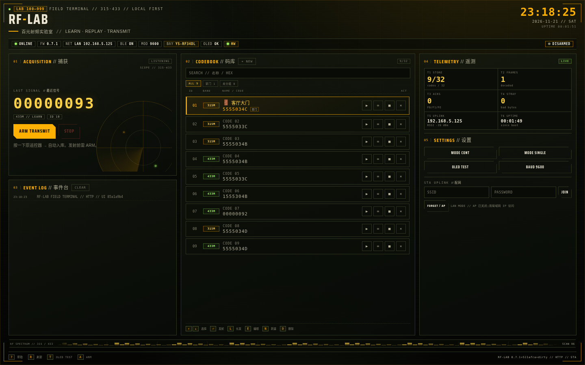
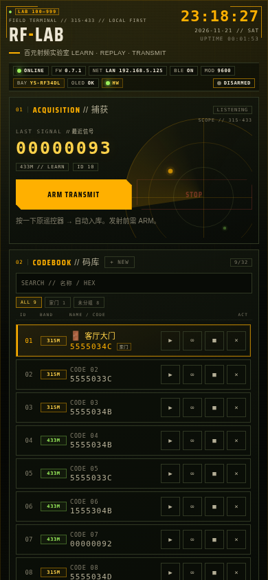
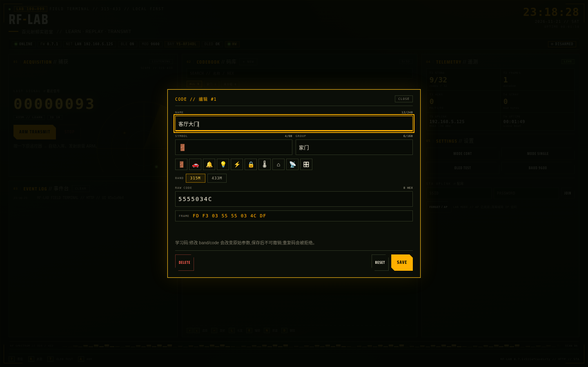

# 2026-11-21 · 码库 v2(0.7.1):9 条旧码迁移 / UTF-8 元数据 / 新建与编辑

状态:**构建 ✅ · 主机测试 ✅ · 真机(HTTP/串口/浏览器)✅ · APK 构建 ✅**
**BLE 链路/码表显示已由 [`2026-11-21-ble-framing.md`](2026-11-21-ble-framing.md) 真机覆盖;码库编辑的 BLE 写入、0.7.0→0.7.1 自更新、GitHub Release 未验证**。

## 1. 构建

```text
cd firmware && pio run -e esp32c3
Flash 1,098,608B / 2,031,616B OTA 槽 · RAM 73,540B / 327,680B
gzip 30,068B · ui 85a1a9b4
```

`APP_CODES_JSON_MAX` 2816→6144 后,HTTP `/api/codes` 改为按请求 `malloc`,
避免 6KB 缓冲区压在 6KB HTTP task 栈上(首版实测会把连接重置)。

## 2. 主机测试

```text
./tools/host_test.sh
rf34dl 76 + codebook 218 + link 9418 + ota_ticket 41 + oled/ui 1286 + tui 12
```

`test_codebook.c` 覆盖:v1 164B 合成 blob 迁移、JSON 转义、32 条最大载荷、
UTF-8 合法/超长/截断/代理区、重复 band+code、`edited`、序列化往返。

## 3. 真机迁移(OTA,保留 NVS)

迁移前(0.6.0,`LIST`):

```text
 1  315M 5555034C
 2  315M 5555033C
 3  315M 5555034B
 4  433M 5555034B
 5  433M 5555033C
 6  433M 1555304B
 7  433M 00000092
 8  315M 5555034D
 9  433M 5555034D
```

`tools/ota.py --host 192.168.5.125 --serial /dev/ttyACM0` → 0.7.1,首启:

```text
# codebook ver=2 count=9/32 migrated=yes
OK stored=9/32
```

迁移后 `LIST` 与迁移前 **逐字节一致**(`diff` 退出 0)。`RESET` 后:

```text
# codebook ver=2 count=9/32 migrated=no
```

说明 v2 `codes2` 已生效;v1 `codes` 仍保留作回滚兜底(回滚看不到 v2 的改名/删除)。

## 4. UTF-8 名称 / 分组 / 符号

经 LAN `POST /api/cmd`(串口输入只接受 ASCII,中文走 Web/BLE):

```text
{"cmd":"NAME 1 客厅大门"}
{"cmd":"GROUP 1 家门"}
{"cmd":"SYM 1 🚪"}
```

`GET /api/codes` 首条:

```json
{"id":1,"band":"315M","code":"5555034C","name":"客厅大门","group":"家门","sym":"🚪"}
```

串口 `LIST LONG` 同步显示 UTF-8;`RESET` 后仍保留。`LIST` 输出仍不含名称,
与迁移前一致。

## 5. Web UI(真机 LAN,非 mock)

- Chromium 1440×900 / 1280×720 / 390×844 打开 `http://192.168.5.125/`,9 行码、分组 chips、
  `家门 1` / `未分组 8`,无横向溢出(1280×720 下 10 条时列表内滚动);`hello.codebook=2`,`+ NEW` 可用。
- 编辑弹层:名称 12/24B、符号 4/8B、分组 6/16B,原始帧预览
  `FD F3 03 55 55 03 4C DF`,学习码提示“改 band/code 不可撤销”;重复码 `5555033C`
  被客户端拦下,错误为“重复码:与 #2 的 315M 5555033C 相同”。
- 真机新建 #10/#11/#12 测试码 → 命名/分组/符号/改 band+code → 删除;测试后恢复到 9 条。
  截图:





- 期间间歇观察到模块自己解出的 `00000093`(id 10,最终已 `ERASE`);原库本就有同族的
  `00000092`,属既有环境/模块噪声,不是码库 v2 生成。

> 现场没有改 #1 的 4B 原始值(只改名称/分组/符号),避免污染已学码;`EDIT band/code`
> 对学习码与手工码走同一函数,已在测试码上真机验证,主机测试覆盖重复/回滚。

## 6. APK 0.7.1

```text
./gradlew assembleRelease
1,050,176B · versionCode 3 · versionName 0.7.1
apksigner verify: v2 scheme true
assets/index.html == web/dist/index.html (sha256 ed65b7f4…)
```

未验证:真机安装、BLE 下码库编辑写入、0.7.0→0.7.1 自更新弹窗、Release 资产。

## 7. 仍未验证

- 手机 BLE 上的 `NAME/GROUP/SYM/EDIT` 写入(链路/码表显示已验,编辑写入未单独验)。
- 旧固件(0.6.x)+ 新 APK 的能力位禁用路径(代码路径,未真机组合)。
- 0.7.1 GitHub Release / SHA256SUMS / 官网版本同步。
- 32 条满库下的 JSON/BLE 快照实测(主机测试覆盖 32 条最大载荷)。
