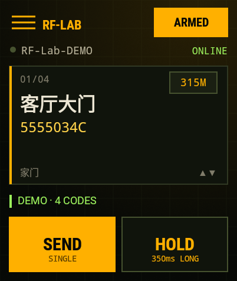
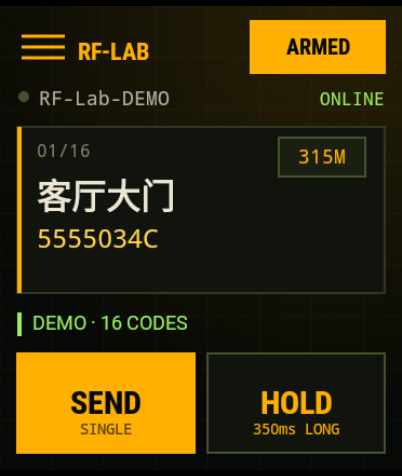
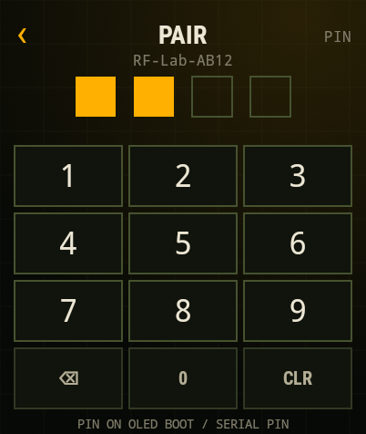
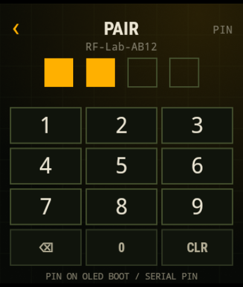
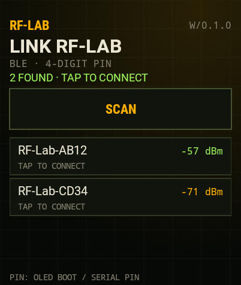
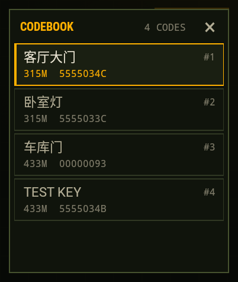
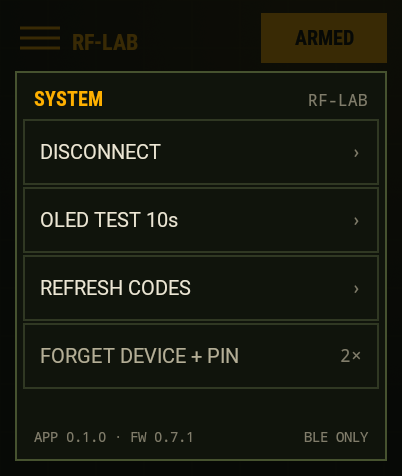
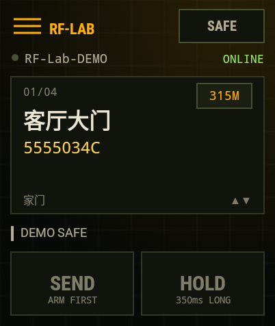
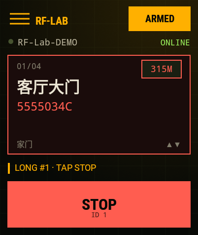

# 2026-11-22 — OPPO Watch 2 客户端(Build / Host / 模拟器)

> **结论:构建、JVM 协议测试、Lint 和 Android 模拟器 UI 已通过。** 本文只记录
> 构建/主机/模拟器;46mm 真机安装与 BLE 控制见
> [`2026-11-22-watch-device.md`](2026-11-22-watch-device.md)。本文不把模拟器截图写成手表截图。

## Build

```bash
./watch/check.sh
```

| 项 | 值 |
|---|---|
| JDK | Temurin 17.0.21 |
| Android SDK | platform 35 / build-tools 35.0.0 |
| Gradle / AGP | 8.11.1 / 8.7.3 |
| 产物 | `watch/app/build/outputs/apk/debug/app-debug.apk` |
| 大小 | 103,784 B |
| sha256 | `7ca5452c72cd24a5bef9f1fe3f30009d8ec22f99c9aac22aed1cb148e574596a` |
| 包名 / 版本 | `dev.rflab.watch` / 0.1.0(versionCode 1) |
| minSdk / targetSdk | 26 / 28(目标 ColorOS Watch 2.0 / API 27) |
| 权限 | `BLUETOOTH_SCAN`/`CONNECT`(31+),`BLUETOOTH`/`ADMIN`/`ACCESS_FINE_LOCATION`(≤30);无 INTERNET |

```text
package: name='dev.rflab.watch' versionCode='1' versionName='0.1.0' ...
minSdkVersion:'26'
targetSdkVersion:'28'
application-label:'RF-Lab'
launchable-activity: name='dev.rflab.watch.WatchActivity'
```

`cd watch && ../android/gradlew lintDebug` 结果:**No issues found**(0 error / 0 warning)。

## Host

```bash
cd watch && ../android/gradlew testDebugUnitTest
```

`ProtocolTest`: **9/9 通过**,覆盖 `hello/auth/codes/state/event/log/error`、32 条满库、
中文/emoji 字段、`"-"` 空字段归一、畸形帧、PIN 校验、选择项循环。纯 JVM,不依赖手表。

## UI(Android 模拟器,不是手表)

AVD:API 27 `default/x86_64`,402×476 @ 320dpi;用 `wm size 372x430` 验证 42mm 档。
仅 `debug` 包支持 `--ez demo true` 的假数据预览;demo 不建立 BLE 连接。
本文件截图来自较早 debug 构建,只用于 42mm/布局参考;最终包的 46mm 真机截图与
交互证据见 [`2026-11-22-watch-device.md`](2026-11-22-watch-device.md)。

| 截图 | 场景 |
|---|---|
|  | 控制页(46mm 基准,ARMED,4 码) |
|  | 控制页(372×430,16 码) |
|  | PIN 键盘(46mm) |
|  | PIN 键盘(372×430) |
|  | LINK / 扫描结果 |
|  | CODEBOOK 浮层 |
|  | SYSTEM 菜单 |
|  | SAFE,`SEND` 禁用 |
|  | 按住 HOLD → LONG;松开前 `RELEASE/STOP` |
|  | PIN 自动提交后的 ONLINE / AUTH OK |

正常包(非 demo)在模拟器启动:设备无 `FEATURE_BLUETOOTH_LE`,显示 `NO BLE` + 雷达空态,
无 crash;这只证明布局/生命周期,不证明 BLE。

**模拟器边界**:AVD 无 BLE 外设,不能验证扫描、GATT、AUTH、`SEND/LONG/STOP`、断链/锁 PIN。

## Device

本文写作时未接手表;后续 46mm `OW20W1` 已完成安装与 BLE 验证,见
[`2026-11-22-watch-device.md`](2026-11-22-watch-device.md)。

当前 RF-Lab 设备(串口 `/dev/ttyACM0`)只用于确认协议端点存在,不作为手表证据:

```text
# RF-Lab fw=0.7.1 (ESP32-C3 + YS-RF34DL)
# build=c4c9378 ui=85a1a9b4
# ble on=on adv=yes conn=no name=RF-Lab-1B59 pin=set
# codebook ver=2 count=32/32 migrated=no
```

## Unverified(模拟器阶段)

> 后续 46mm 真机已覆盖扫描/连接/AUTH/SEND/LONG/STOP 与错误 PIN,见
> [`2026-11-22-watch-device.md`](2026-11-22-watch-device.md)。本列表只表示
> 模拟器阶段没有这些能力。

- OPPO Watch 2 的开发者选项 / ADB 入口 / 数据连接方式(USB、WLAN 或 OTG);
- ColorOS Watch 2.0 是否允许侧载 `dev.rflab.watch`、安装后能否启动;
- 真机 BLE 扫描到 `RF-Lab-*`、连接、MTU、CCCD、AUTH、错误 PIN 5 次;
- `SEND` / `LONG` / `STOP` 与设备 OLED/串口回显;长发中断链/退后台的 STOP;
- 402×476 与 372×430 真机玻璃圆角、触控命中、字体缩放;
- 息屏/省电策略下 BLE 是否被系统挂起;PIN 明文保存在 APP 私有目录的接受度。

## Key judgments

| 判断 | 为什么 | 避免的误修 |
|---|---|---|
| `targetSdk 28` | 目标机是 API 27;提高 target 会改 BLE/定位权限行为,且不走 Play | 为消 lint 盲目升 target,结果在手表上请求不到旧权限 |
| 单码卡片 + 按住 HOLD | 手表宽度不足以放码库表;长发没有天然超时 | 把手机 WebView 塞进手表,或做持久 LONG 把 STOP 藏起来 |
| STOP 后不立刻清 `txActive` | 写成功 ≠ 设备已停;要等 `event stop`/state | 乐观清状态,断链时误以为已停 |
| PIN 自动提交/记忆 | 手表输入 4 位成本高 | 每次重连都让用户在小键盘上敲 |
| 不做后台 Service | 续航与系统限制;长发必须在前台可见 | 用前台服务保活,用户看不见还在发射 |
