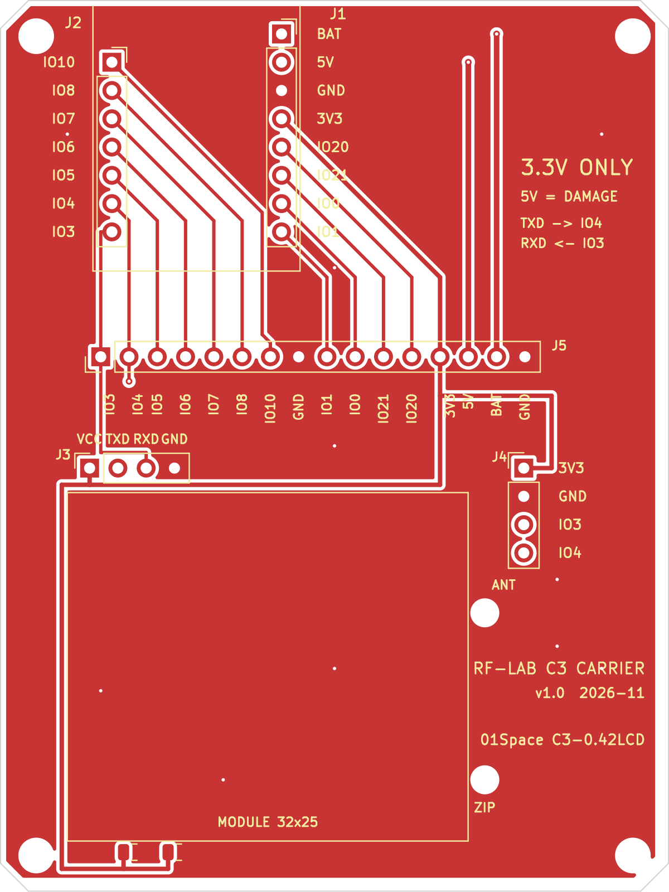

# RF-Lab C3 底板 v1.0

**状态:设计完成、DRC/ERC 通过、Gerber 已导出;未打样、未上机。** 2026-11-23

一块 60 × 80 mm、2 层、全直插的“插座底板”,把现在用杜邦线吊着的
**01Space ESP32-C3-0.42LCD** 和 **YS-RF34DL 315/433 MHz 模块**固定成两块可插拔的板:
C3 板插在左侧 2×7/8 母座上,射频模块插在 J3 母座上,两者都能直接拔换。

> 尺寸在嘉立创免费打板范围内(≤100×100 mm、2 层、绿油、HASL、5 片)。
> **打样前务必打印 [`fab/check-1to1.pdf`](fab/check-1to1.pdf) 按 100% 比例,把 C3 板压上去核对插座孔位。**



| 项目 | 值 |
|---|---|
| 板尺寸 | 60.0 × 80.0 mm,2 层,1.6 mm,1 oz |
| 工艺 | 绿油白字、HASL、无铅(嘉立创免费档) |
| 连接器 | 全 2.54 mm 直插;J1/J2/J3 母座,J4/J5 公排针 |
| 安装 | 4 × M2.5 NPTH(2.7 mm),2 × 2.1 mm 天线/扎带孔 |
| 供电 | 仅 3.3 V;由 C3 板的 3V3 引脚供给模块,板上无稳压器 |
| 额外 | C1 10 µF + C2 100 nF(0805,3V3 去耦,可选) |
| 铜 | 双面 GND 铺铜 + 10 个缝合过孔;信号/电源走线 0.25–0.5 mm |

## 1. 它解决什么问题

现役接法是 C3 板 + 4 根杜邦线 + 模块,换模块/换板都要重新插线,还容易把
VCC/GND 插反。底板把 4 根线固化:

- **C3 板可拔**:两个标准 2.54 母座(1×7 + 1×8),不用焊死在底板上。
- **模块可拔**:J3 是 1×4 母座,模块直接插;旁边 J4 再引一组同样的
  `3V3/GND/IO3/IO4`,接别的串口模块时不用改板。
- **所有剩余 GPIO 引出**:J5(1×16)把 11 个 GPIO 和 3V3/5V/BAT/GND 全部引出。
- **嘉立创免费档**:60×80 mm、2 层、全直插,不需要 SMT 贴片。

## 2. 接口与引脚

### 2.1 C3 插座 J1 / J2(面向底板,USB 朝上)

| 位置 | 1 | 2 | 3 | 4 | 5 | 6 | 7 | 8 |
|---|---|---|---|---|---|---|---|---|
| **J1(8 pin,右列)** | BAT | 5V | GND | 3V3 | IO20 | IO21 | IO0 | IO1 |
| **J2(7 pin,左列)** | IO10 | IO8 | IO7 | IO6 | IO5 | IO4 | IO3 | — |

- 两排**中心距 15.24 mm**(6 × 2.54),针距 2.54;两排**在 Qwiic 端对齐**,
  8 pin 排在 USB 端多出一针 —— 与 01Space 原板一致。
- J1/J2 的 **1 脚是方焊盘**,靠 USB 端;插反了 C3 板的 BAT 会落到 5V 上。
- 丝印已把每一针的网名印在插座外侧;插上 C3 板后仍可见。

### 2.2 模块座 J3(1×4 母座)

| 针 | 1 | 2 | 3 | 4 |
|---|---|---|---|---|
| 网名 | **3V3** | **IO4** | **IO3** | **GND** |
| 模块侧 | VCC | TXD | RXD | GND |

模块的 4 针顺序按你确认的 **VCC → TXD → RXD → GND**(从正面、天线端数)。
交叉关系:**模块 TXD(2)→ C3 的 IO4(RX)**,**模块 RXD(3)← C3 的 IO3(TX)**。

> **接反 VCC/GND 会烧模块。** 上电前用万用表量 J3.1–J3.4 应为 3.3 V;
> 若你的模块丝印顺序不是 VCC/TXD/RXD/GND,**不要插 J3**,改用 J4 飞线。

### 2.3 备用座 J4(1×4 公排针)

| 针 | 1 | 2 | 3 | 4 |
|---|---|---|---|---|
| 网名 | 3V3 | GND | IO3 | IO4 |

### 2.4 全引出 J5(1×16 公排针)

| 针 | 1 | 2 | 3 | 4 | 5 | 6 | 7 | 8 |
|---|---|---|---|---|---|---|---|---|
| 网名 | IO3 | IO4 | IO5 | IO6 | IO7 | IO8 | IO10 | GND |

| 针 | 9 | 10 | 11 | 12 | 13 | 14 | 15 | 16 |
|---|---|---|---|---|---|---|---|---|
| 网名 | IO1 | IO0 | IO21 | IO20 | 3V3 | 5V | BAT | GND |

- 1 脚方焊盘在**左侧**(靠近 J2)。
- 11 个 GPIO 全部引出;IO20/IO21 同时是 UART0 控制台,引出不影响现役固件。
- **BAT 是电池输入脚**,不是稳压输出;不要把它当 3.3 V 源。

### 2.5 与 `hardware/wiring.json` 的关系

`gen_pcb.py` 启动时会读 `../wiring.json`,断言 `module_tx=3`、`module_rx=4`、
`console=20/21`、`oled=5/6`;改接线先改 JSON,再重跑生成器。PCB 的 4 根模块线
不是第二套定义。

## 3. BOM(全部可手焊)

| 位号 | 规格 | 数量 | 备注 |
|---|---|---|---|
| J1 | 2.54 mm 1×8 **母座** | 1 | 可用 1×40 排母剪 |
| J2 | 2.54 mm 1×7 **母座** | 1 | 同上 |
| J3 | 2.54 mm 1×4 **母座** | 1 | 模块座 |
| J4 | 2.54 mm 1×4 **公排针** | 1 | 备用模块口 |
| J5 | 2.54 mm 1×16 **公排针** | 1 | 全引出 |
| C1 | 10 µF 16 V X5R 0805 | 1 | 可选,3V3 储能 |
| C2 | 100 nF 50 V X7R 0805 | 1 | 可选,去耦 |
| H1–H4 | M2.5 螺丝/铜柱 | 4 | 2.7 mm 孔 |
| — | 17–23 cm 单芯天线 | 1 | 焊在模块天线焊盘 |

CSV:[`fab/bom.csv`](fab/bom.csv)。

## 4. 装配顺序

1. 先焊 J1、J2、J3 三个**母座**,再焊 J4、J5 两个公排针;最后焊 C1/C2(可选)。
2. 断电,万用表检查:
   - J3.1–J3.4 之间**不能短路**;
   - J1.3(GND)与 J1.4(3V3)之间不能短路;
   - J5.8 / J5.16 与 J1.3 通。
3. 把 C3 板插进 J1/J2:**USB 朝底板的上边缘**,J1 的方焊盘对 C3 的 BAT 针。
4. 上电(USB),量 J3.1 对 J3.4 应为 **3.3 V**。
5. 断电,插模块(J3.1=VCC),接天线,再上电。
6. 用 `INFO` / 串口确认模块有应答;第一次不要直接长发射。

**禁止**:5 V 进 J3.1 或 C3 的 GPIO;不接天线长时间发射;带电插拔模块。

## 5. 嘉立创免费打板

1. 打开 [嘉立创下单页](https://www.jlc.com/) / 嘉立创下单助手,选 **PCB 下单**。
2. 上传 [`fab/rf-lab-c3-carrier-gerbers.zip`](fab/rf-lab-c3-carrier-gerbers.zip)(46 KB,
   含 7 个 Gerber(铜/阻焊/丝印/板框)+ PTH/NPTH 两个钻孔文件 + gbrjob)。
3. 参数:
   - 层数 **2**,尺寸自动识别 **60 × 80 mm**;
   - 板厚 **1.6 mm**,铜厚 **1 oz**,材质 FR-4;
   - 阻焊 **绿色**,丝印 **白色**,表面处理 **HASL(有铅/无铅按活动)**;
   - 数量 **5**,“PCB 只做板,不贴片”。
4. 免费档通常要求:**≤100×100 mm、2 层、1.6 mm、绿油、HASL、5 片**;
   板费可免,**运费和加急/彩色/沉金另计**,以当期活动为准。
5. 下单前预览生产稿:确认 **板框 60×80、4 个 M2.5 孔、2 个天线孔、J1/J2 两排孔**都在。
6. **首件先打 1:1 纸样**:打印 [`fab/check-1to1.pdf`](fab/check-1to1.pdf),打印设置选
   **100% / 实际大小**(不要“适合页面”)。纸样页尺寸 60.1×80.1 mm;把 C3 板压上去,
   15 个插座孔应一一对齐。对不上就先别下单。

## 6. 设计验证(证据)

| 项 | 结果 | 命令/文件 |
|---|---|---|
| PCB DRC | **0 violations,0 unconnected** | `kicad-cli pcb drc --severity-all --exit-code-violations` |
| 原理图 ERC | **0 电气错误**,7 条 `lib_symbol_issues` 警告(符号已内嵌,仅库名未注册) | `kicad-cli sch erc` |
| Gerber | 7 个 Gerber + PTH 52 孔 + NPTH 6 孔,zip 46 KB | `fab/rf-lab-c3-carrier-gerbers.zip` |
| 1:1 纸样 | 170.35 × 227.02 pt = 60.1 × 80.1 mm | `fab/check-1to1.pdf` |
| 丝印/焊盘预览 | 顶层/底层/原理图 | `img/top.png`、`img/bottom.png`、`img/schematic.pdf` |
| 打样 | **未做** | — |
| 上机(插拔/供电/发射/距离) | **未做** | — |

SHA-256:

```
a2909ef3eff3edc911d390ac7712ad322066cf0819f7020652b548c484943c95  fab/rf-lab-c3-carrier-gerbers.zip
d51fd27e1226e4d33e344f1fc7a35ffdb994b9f916809e6ab2423b5f49403b70  fab/check-1to1.pdf
623c9621dbc854c5b6c486045d6c309e7fdff08ec2e7a44094ed4ec66d6920f8  rf-lab-c3-carrier.kicad_pcb
```

## 7. 风险与未验证项(★ 打样前看)

| # | 风险 | 后果 | 处理 |
|---|---|---|---|
| 1 | **C3 插座跨距按 15.24 mm 画**;不同批次/克隆板可能是 16 或 17.78 mm | 插不进去 | 先打 1:1 纸样;若实测不同,需要改布局重画(不是改一个数) |
| 2 | **模块 4 针顺序按 VCC/TXD/RXD/GND** | 接反烧模块 | 上电前量 J3.1–J3.4;不确定就用 J4 飞线 |
| 3 | 5 V 直接进 3V3/GPIO | 烧模块/烧 C3 | 板上丝印 `3.3V ONLY / 5V = DAMAGE`;无 5 V 输入口 |
| 4 | 无电源开关、无防反接、无电平转换 | 模块常带电;5 V 模块需另做电平 | 不用时拔 USB;5 V 改造见 `hardware/README.md` §4 |
| 5 | 模块悬在 J3 上,只有 4 根针受力 | 反复插拔/拉天线会松 | 用 ANT/ZIP 孔扎带固定模块和天线 |
| 6 | 免费打板是活动/优惠券,不是永久 | 下单时可能收费 | 以嘉立创当期活动为准;板费之外还有运费 |
| 7 | 0805 C1/C2 接在整片 GND 铜上 | 手焊散热快 | 可先不焊;需要时用烙铁+助焊剂或热风 |
| 8 | 未做 EMC/ESD/射频匹配 | 433 MHz 距离未验证 | 只做载体,射频性能取决于模块和天线 |

## 8. 设计与取舍(为什么这样)

- **用两个标准母座而不是画 C3 的定制封装**:C3 板可拔换、母座便宜、坏了好换;
  代价是必须精确知道两排针的跨距(见风险 1)。
- **J5 用 1×16 单排,不用 2×8**:单排每根信号都从上方进针,两组扇出
  (J2 左侧 7 根、J1 右侧 8 根)不交叉;2×8 的第二排会被第一排挡住。
- **双面 GND 铺铜 + 实心连接**:DRC 干净、回流短;代价是 0805 焊盘散热快。
- **5V/BAT 走底层、IO3/IO4 到 J4 走底层**:顶层丝印和 C3 扇出保持干净。
- **全直插 + 0805 可选**:嘉立创只做板,不产生 SMT 费用;0805 手焊难度可接受。
- **J3 的 TXD/RXD 交叉在板上完成**:模块 TXD→IO4、RXD←IO3,插上就是交叉,
  不需要再记杜邦线怎么接。

## 9. 重新生成

```bash
cd hardware/pcb
python3 gen_pcb.py                 # 生成未铺铜的 .kicad_pcb
./fill_zones.sh rf-lab-c3-carrier.kicad_pcb   # KiCad 9.0.8 无头铺铜(见下)
python3 gen_sch.py                 # 生成 .kicad_sch
kicad-cli pcb drc --severity-all --exit-code-violations rf-lab-c3-carrier.kicad_pcb
kicad-cli pcb export gerbers -o fab/gerbers/ -l F.Cu,B.Cu,F.Paste,B.Paste,F.Silkscreen,B.Silkscreen,F.Mask,B.Mask,Edge.Cuts --no-x2 rf-lab-c3-carrier.kicad_pcb
kicad-cli pcb export drill -o fab/gerbers/ --format excellon --drill-origin absolute --excellon-units mm --excellon-zeros-format decimal --excellon-separate-th rf-lab-c3-carrier.kicad_pcb
```

> **不要在 KiCad 里“从原理图更新 PCB”。** 这块板的布局/走线由 `gen_pcb.py`
> 生成,原理图(`gen_sch.py`)只是同一组网名的可读视图;直接 Update 会把走线冲掉。
> 要改布局,改 `gen_pcb.py` 后重跑上面两条,再重新铺铜。

**为什么要 `fill_zones.sh`**:本机 KiCad 9.0.8 的 Python `ZONE_FILLER` 在没有
`PCB_EDIT_FRAME` 时会段错误;脚本用 `xvfb-run` 起真正的 pcbnew,按 `B` 铺铜、
`Ctrl+S` 保存。需要 `xvfb`、`xdotool`。改完布局后必须重新铺铜,否则 Gerber 里
只有空的铜皮轮廓。

## 10. 文件

| 文件 | 内容 |
|---|---|
| [`rf-lab-c3-carrier.kicad_pcb`](rf-lab-c3-carrier.kicad_pcb) | 已铺铜的 KiCad 9 PCB |
| [`rf-lab-c3-carrier.kicad_sch`](rf-lab-c3-carrier.kicad_sch) | 单页原理图(网名标注式) |
| [`gen_pcb.py`](gen_pcb.py) | PCB 生成器(布局/走线/丝印/铺铜) |
| [`gen_sch.py`](gen_sch.py) | 原理图生成器 |
| [`fill_zones.sh`](fill_zones.sh) | 无头铺铜脚本 |
| [`fab/rf-lab-c3-carrier-gerbers.zip`](fab/rf-lab-c3-carrier-gerbers.zip) | **嘉立创上传用** |
| [`fab/check-1to1.pdf`](fab/check-1to1.pdf) | **1:1 纸样**,打印后核对插座 |
| [`fab/bom.csv`](fab/bom.csv) | 手焊 BOM |
| [`img/top.png`](img/top.png) / [`img/bottom.png`](img/bottom.png) | 顶层/底层预览 |
| [`img/schematic.pdf`](img/schematic.pdf) | 原理图 PDF |
