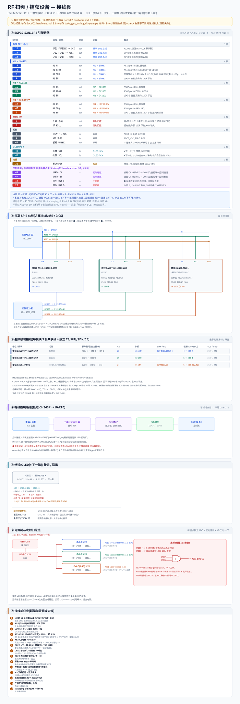

# 接线图与引脚分配

状态:`draft` · 最后更新:2026-10-31 · 上游依据:[`docs/02-hardware.md`](../../docs/02-hardware.md) §3、[`docs/01-product.md`](../../docs/01-product.md) §8

> ⚠️ **本文件与 [`wiring-diagram.svg`](wiring-diagram.svg) 均由 [`tools/gen_wiring_diagram.py`](../../tools/gen_wiring_diagram.py) 生成,不要手工编辑。**
> 引脚分配的人工权威是 `docs/02-hardware.md` §3,生成器的 `PINS` 是它的镜像;要改引脚:**先改 `docs/02-hardware.md` §3 → 再改生成器的 `PINS` → 重跑生成器**。
> `--check` 会:① 重算占用/余量/实装根数并核对预算;② 检查文本不压字、面板内容不溢出;③ 把 SVG/README 重新生成到临时目录并与仓库文件**逐字节比对**,不一致即报「生成物过期」退出 1。但**文档表与 `PINS` 之间仍需人工同步**,自检不能替你读懂表格。



> 两种格式同一张图:**[`wiring-diagram.svg`](wiring-diagram.svg)** 是权威矢量图(可无损放大、可在浏览器或绘图软件里打开与标注);**[`wiring-diagram.png`](wiring-diagram.png)** 是同一张图的位图渲染(手机浏览器与文件管理器对 SVG 支持不稳,现场看图用 PNG)。两者都是生成物。

---

## 1. 引脚分配(计入引脚预算)

| GPIO | 信号 / 网络 | 方向 | 归属 | 备注 |
|---|---|---|---|---|
| **12** | `SPI2 FSPICLK → SCK` | out | 共享 SPI2 总线 | IO_MUX 直连(FSPICLK 默认脚) |
| **13** | `SPI2 FSPID → MOSI` | out | 共享 SPI2 总线 | GPIO 矩阵路由(非默认脚) |
| **14** | `SPI2 FSPIQ → MISO` | in | 共享 SPI2 总线 | GPIO 矩阵路由(非默认脚) |
| **15** | `M1 CS` | out | M1 · Si4463 | AS10 pin5 NSEL,低有效 |
| **18** | `M1 nIRQ` | in | M1 · Si4463 | AS10 pin9;Si4463 nIRQ(不是 GDO0) |
| **9** | `M1 SDN` | OD | M1 · Si4463 | 开漏输出 + 外部 100k 上拉 3.3V;POR 脉冲:释放(高)≥100µs → 拉低 |
| **4** | `M1 EN` | out | M1 · Si4463 | LDO-A 使能,高有效;100k 下拉 |
| **16** | `M2 CS` | out | M2 · CC1101 | AS07 pin4 CSN,低有效 |
| **21** | `M2 GDO0` | in | M2 · CC1101 | AS07 pin3;CC1101 GDO0 |
| **5** | `M2 EN` | out | M2 · CC1101 | LDO-B 使能,高有效;100k 下拉 |
| **17** | `M3 CS` | out | M3 · nRF24+PA | AS01 pin4 CSN,低有效 |
| **47** | `M3 IRQ` | in | M3 · nRF24+PA | AS01 pin8;nRF24 IRQ |
| **6** | `M3 EN` | out | M3 · nRF24+PA | LDO-C 使能,高有效;100k 下拉;上电默认低 |
| **7** | `2.4G 总闸` | out | 发射门控 | 高=软件允许;上电默认低;AND 输入(不新增 CE 脚) |
| **8** | `RF KILL` | out | 发射门控 | 低有效;外部 100k 下拉;AND 输入 |
| **1** | `电池分压 ADC` | in | 系统 | ADC1_CH0,经 1:2 分压 |
| **2** | `NTC 温度` | in | 系统 | ADC1_CH1,10kΩ 分压 |
| **48** | `板载 WS2812` | out | 系统 | ✅ 已核实 GPIO48;单线可寻址,占用 RMT |
| **40** | `OLED SDA` | io | OLED I²C ⏸ | ⏸ 下一批(I²C 预留,本批不装) |
| **41** | `OLED SCL` | io | OLED I²C ⏸ | ⏸ 下一批;与 JTAG(39–42)冲突,本产品已放弃 JTAG |
| **38** | `配对按键` | in | 按键 | 内部上拉,低有效;外并 100nF 去抖 |

### 控制通道 / 不可用脚(**不新增占用**)

| GPIO | 信号 | 方向 | 备注 |
|---|---|---|---|
| **43** | `UART0 TX` | — | 板载 CH343P(RX)→ COM 口;当前唯一控制通道 |
| **44** | `UART0 RX` | — | 板载 CH343P(TX)→ COM 口;当前唯一控制通道 |
| **19** | `原生 USB D−` | — | ⛔ 从未枚举成功:不可用、非控制通道 |
| **20** | `原生 USB D+` | — | ⛔ 同上;JTAG 随之失去,勿设计成 OTG 控制口 |

43/44 是 UART0,经开发板板载 **CH343P**(COM 口,VID:PID `1a86:55d3`)成为控制通道;19/20 是 ESP32-S3 原生 USB,本板**从未枚举成功**,不可用、不作为控制通道(JTAG 随之失去)。两者都不计入占用。

---

## 2. 引脚预算核算

| 类别 | 根数 | GPIO |
|---|---|---|
| 射频侧 | 15 | `4,5,6,7,8,9,12,13,14,15,16,17,18,21,47` |
| 系统 | 3 | `1,2,48`(48 = 板载 WS2812,✅ 已核实);39 因蜂鸣器不存在而释放 |
| OLED I²C | **(2)** | `40,41` —— ⏸ **下一批**(引脚已预留,不计入本批实装的 19 根) |
| 配对按键 | 1 | `38`(2026-09-21 由 48 改来:48 实为指示灯) |
| 控制通道 | **0** | `43,44` 复用 UART0(CH343P);`19,20` 原生 USB 不可用 |
| **合计占用** | **21** | 含 OLED 预留 2 根 |
| **可用池** | **25** | 29 个候选(45 GPIO − 16 不可用:26–37、19/20、43/44 = 29)− 4 strapping(`0/3/45/46`)= **25** |
| **余量** | **+4** | 本批实装 19 根 ⇒ 当前 **+6** |

**余量的边界**:+4 根够用,但**不足以再加一条 SPI 主机**(需 3 根,且只能走 GPIO Matrix,时钟质量更差)。这正是「单 SPI2 总线 + 3 CS」(§4)成立的原因。

---

## 3. 三模块接线

共享三线(SCK/MOSI/MISO),各自独立 **CS / 中断 / 使能**;M1 另有 **SDN**,M3 的 **CE** 由 AND 门驱动。模块官方针序见 [`docs/02-hardware.md`](../../docs/02-hardware.md) §3.1 与 [`as10-pin-card.png`](as10-pin-card.png)。

| 槽位 | 模块 | 芯片 | 模块脚号(官方针序) | 共享 | CS | 中断 | SDN / CE | 电源 | VCC/GND |
|---|---|---|---|---|---|---|---|---|---|
| 1 | AS10-M4463D-SMA | Si4463 | `NSEL=5 · IRQ=9 · SDN=2` | `SCK 12 / MOSI 13 / MISO 14` | **15** | **18**(nIRQ) | SDN=**9**(开漏)+ 外部 100k↑ | EN=4 → LDO-A | 3.3V / GND |
| 2 | AS07-M1101D-SMA | CC1101 | `CSN=4 · GDO0=3` | `SCK 12 / MOSI 13 / MISO 14` | **16** | **21**(GDO0) | — | EN=5 → LDO-B | 3.3V / GND |
| 3 | AS01-ML01 | nRF24L01P+RFX2401C | `CSN=4 · IRQ=8 · CE=3` | `SCK 12 / MOSI 13 / MISO 14` | **17** | **47**(IRQ) | CE=**AND(7,8)**(pin3) | EN=6 → LDO-C(2.4G) | 3.3V / GND |

- **AS10(M1)SDN 由 GPIO9 控制(开漏)**:GPIO9 为**开漏输出** + 外部 **100kΩ 上拉到 3.3V**(上电默认 shutdown);POR 脉冲:**释放(上拉为高)≥100µs → 驱动低 → 等 ≥10ms**,再初始化 SPI。开漏高=高阻,即使旧现场仍把 SDN 接 GND 也**不会短路**(但拉不高、必须改接 GPIO9)。
- **AS01(M3)没有独立 EN 脚**:模块电源由 LDO-C(EN=GPIO6)控制;**CE(pin3)由 AND(GPIO7,GPIO8) 输出直接驱动**。`CE=0 ⇒ nRF24 power-down、PA 不工作`;KILL 保持低时,M3 仍可由 GPIO6 上电做 SPI 只读探测(CE 低,不发射);M3 收发必须 GPIO7=1 **且** KILL 释放。**不新增 CE GPIO**。
- 每模块只用 1 根中断:Si4463 `nIRQ` / CC1101 `GDO0` / nRF24 `IRQ`;其余中断脚按芯片可空(Si4463 GPIO0–3;CC1101 GDO1/GDO2)。**M1 的中断叫 nIRQ,不是 GDO0。**
- **天线:三支独立 SMA 座,禁止并联或用合路器**(失配 + 违背 C-02)。

---

## 4. 共享 SPI2 总线

```
ESP32-S3 SPI2_HOST          三条独立 SPI 网络,分别并联到 3 个模块
    SCK  12 ────┬───────────┬───────────┬────► M1 / M2 / M3 SCK
    MOSI 13 ────┼───────────┼───────────┼────► M1 / M2 / M3 MOSI
    MISO 14 ────┴───────────┴───────────┴────► M1 / M2 / M3 MISO

    三根 CS 各自独立,与上面三线没有任何共点:
    CS 15 ───────────────────────────────────► M1 NSEL(AS10 pin5)
    CS 16 ───────────────────────────────────► M2 CSN(AS07 pin4)
    CS 17 ───────────────────────────────────► M3 CSN(AS01 pin4)
```

- **IO_MUX**:只有 **SCK(12)是 `FSPICLK` 默认脚**,走 IO_MUX;**MOSI(13)/MISO(14)不是**(S3 的默认是 `FSPID=GPIO11`、`FSPIQ=GPIO13`、`FSPIWP=GPIO14`),必须经 **GPIO 矩阵**路由。1MHz 下矩阵损失可忽略;提高时钟前须实测波形。
- 由 `rf_hal` 串行化;**禁止在 CS 有效期间插入日志 / JSON / NVS 写**(否则错帧)。
- ⚠️ 协议上报的 `bus` 是**整数 `2`**(`SPI2_HOST`),**不是字符串 `"spi2"`** —— schema 为 `integer` 且 `additionalProperties:false`,上报字符串会被开发期校验判非法。

---

## 5. 有线控制通道(CH343P → UART0)

```
手机(USB 主机)──► 开发板 Type-C「COM」口 ──► CH343P(1a86:55d3)──► UART0
                                                        GPIO43 = TX / GPIO44 = RX
                                                        ⇄ ESP32-S3 控制流(921600)

原生 USB(GPIO19 D− / GPIO20 D+):本板从未枚举成功 ──► 不可用、不是控制通道
```

- **控制通道就是那块开发板自带的 CH343P(COM 口),载板无需另做 USB 控制口**;插上后主机出现 CDC-ACM 设备 `1a86:55d3 → /dev/ttyACM0`。
- CH343P 的 DTR/RTS 接了自动复位:**打开 COM 口会让设备复位一次**,App 必须处理。
- ⛔ **原生 USB 19/20 不可用**:本板实测从未枚举成功;**JTAG 随之失去**(39–42 已放弃)。不要把它设计成 OTG / 控制通道,也不要承诺保留 JTAG。
- console / 调试日志走 UART0(与协议帧同一物理口):量产固件**必须关闭非协议输出**,否则 App 会在控制通道读到日志。
- 设备**自行供电**,不依赖手机 OTG 供电(手机过流保护会导致掉电重启)。

---

## 6. 电源树与发射门控链

```
USB-C 5V / 18650                                            ┌── 100µF+100nF×2 ─► M1 VCC
     │                                                      │
     ▼                                                      │
 DC-DC 降压(3.3V,≥2A) ──┬── 3.3V 主轨 ─► 主控 / 按键 / LED
                        │
                        ├── LDO-A(EN←GPIO4,100k↓) ──────────┤
                        ├── LDO-B(EN←GPIO5,100k↓) ── 100µF+100nF×2 ─► M2 VCC
                        └── LDO-C(EN←GPIO6,100k↓) ── 100µF+100nF×2+470µF+π 滤波 ─► M3 VCC

GPIO7(2.4G 总闸,上电默认低) ──┐
                             ├──► AND 门 ──► AS01 pin3 CE
GPIO8(RF_KILL,低有效,100k↓) ─┘
```

- **布尔式**:`M3 CE = GPIO7 ∧ GPIO8`(单门 AND 输出直接接 AS01 pin3);**M3 模块电源**则单独由 `LDO-C EN = GPIO6` 软件使能。两个门控对象不同,不存在双驱动。
- **CE=0 ⇒ nRF24 处于 power-down、PA 不工作**;KILL 低时 CE 被 AND 门钳在 0。
- **KILL 保持低时 M3 仍可被探测**:GPIO6 给 LDO-C 上电、CE 保持低,nRF24 处于 power-down,SPI 只读探测安全、不会发射;M3 收发必须 GPIO7=1 且 KILL 释放。
- **KILL 必须外部下拉**、**LDO EN(4/5/6)各加 100kΩ 下拉**:上电、复位、MCU 崩溃期间 EN/KILL 浮空会被读成高 ⇒ 模块意外上电或意外允许发射。
- 模块 VCC **标称 3.3V**:DC-DC 3.3V 经低 dropout LDO,实测 **3.0–3.3V**;三模块均可在 **1.8–3.6V** 内工作,实测偏低不是故障。
- ⚠️ **`RF_KILL` 在协议契约里没有定义** —— 它只存在于硬件文档 §3.3/§4(GPIO8)与固件文档(启动顺序与已知缺口)。App 无法查询门控状态;建议补进契约的 `STATUS`/`CAPS`。
- 每模块独立 LDO + 就近储能:20dBm 的 µs 级电流阶跃靠 LDO 环路来不及。M3 不工作时可关 LDO-C 轨(GPIO6=0)以省电。

---

## 7. 外设

| 外设 | 引脚 | 接线要点 |
|---|---|---|
| OLED SSD1306 0.96" 128×64 ⏸ **下一批不装** | SDA 40 / SCL 41(预留) | **必须 I²C 4 针版**;4.7kΩ 上拉 3.3V;供电取主 3.3V,**不挂 M3 键控轨**。**本批把 40/41 留空,不要挪用**;⚠️ 40/41 与 JTAG(39–42)冲突,本产品原生 USB/JTAG 不可用、已放弃 JTAG |
| 配对按键 SW1 | 38 | 内部上拉,低有效;外并 100nF 去抖;**不可用 BOOT 键复用**。⚠️ 2026-09-21 由 48 改来 |
| 板载 WS2812 | **48** | ✅ **已核实**:单线**可寻址** RGB LED,不是普通 GPIO 灯 ⇒ 驱动占 RMT;⚠️ **停更即保持最后颜色**,故 `KILL` 必须由固件**显式写黑**;⚠️ 山寨板可能**未焊接 2812 信号** |
| 电池分压 | 1 | ADC1_CH0,1:2 分压 |
| NTC 温度 | 2 | ADC1_CH1,10kΩ 分压 |

### 7.1 使用与存储

- **USB 线分两种,别买错**:充电线常只有电源两根线,无 D+/D−,插上不通信。需**数据线**;手机侧接 **OTG 转接头/线**(手机作 USB 主机)。
- 本图交付物是 **SVG 矢量图 + PNG 位图**,可直接在浏览器打开、打印或导入绘图软件标注。
- AS10 模块针序/认 pin1 见 [`as10-pin-card.png`](as10-pin-card.png)(现场引脚定位卡)。

---

## 8. 接线前必查

| # | 检查项 | 踩错的后果 |
|---|---|---|
| 1 | M3 的 CE 必须由 AND(GPIO7,GPIO8) 驱动 | 直连 GPIO 或悬空会让 RF_KILL 形同虚设 |
| 2 | KILL(GPIO8)必须外部 100k 下拉 | 上电/复位期间可能意外允许发射 |
| 3 | LDO EN 4/5/6 各加 100k 下拉 | EN 浮空可能让模块意外上电 |
| 4 | AS10 SDN 接 GPIO9(开漏)+ 100k 上拉 3.3V | OD 高=高阻,旧接 GND 不短路但也拉不高;POR 缺失 ⇒ SPI 不响应、读数全 0xFF |
| 5 | AS10 上电做 POR 脉冲 | 释放(OD 高)≥100µs → 拉低 → 等 ≥10ms,再初始化 SPI |
| 6 | OLED ⏸ 下一批:40/41 预留(与 JTAG 冲突) | 本批不装;已放弃 JTAG,挪用了下一批就要改板 |
| 7 | OLED 必须 I²C 4 针版(下一批) | SPI 版(4–7 根)几乎吃光 +4 的全部余量 |
| 8 | OLED 不挂 M3 键控轨(下一批) | 否则关模块时屏幕一起灭 |
| 9 | 原生 USB 19/20 不可用 | 本板从未枚举成功;不要设计成控制通道/OTG |
| 10 | 控制口 = 板载 COM(CH343P)数据线 | 充电线无 D+/D−,插上不通信 |
| 11 | M3 天线拉远 + 正交极化 | 20dBm 会压掉本机 Wi-Fi/BLE |
| 12 | 每模块独立 LDO + 就近 100µF | µs 级电流阶跃导致复位或频谱劣化 |
| 13 | 三根天线不可并联 / 合路 | 失配 + 违背 C-02 |
| 14 | strapping 0/3/45/46 一律不用 | 上电模式误判 |

