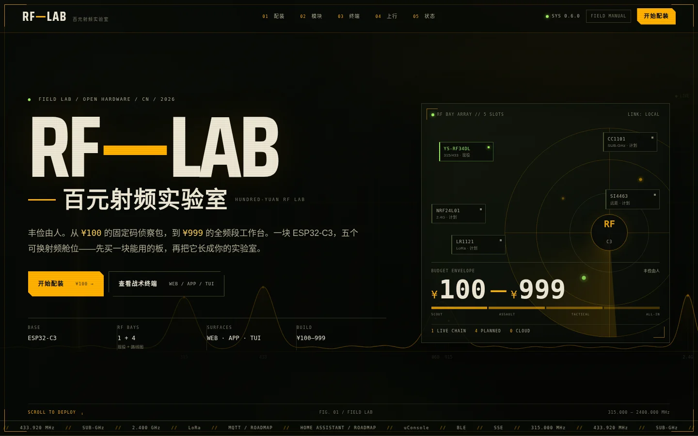

# site/ — RF-LAB 官网 / 配装台

**线上:** <https://heiheiheiheiheihei.github.io/rf-lab/> · **部署:** GitHub Pages / Actions(见文末)

静态单页,把项目从“315/433 固定码工具”讲成“¥100–999 的模块化射频实验室”。
无构建、无外部字体、无 CDN、无网络请求;直接打开 `site/index.html` 就能看。



## 本地查看

```bash
# 方式 1:直接打开
xdg-open site/index.html

# 方式 2:起一个本地静态服务(推荐,相对链接行为与部署一致)
python3 -m http.server 8088 -d site
# http://127.0.0.1:8088/
```

## 页面结构

| 区块 | 内容 | 交互 |
|---|---|---|
| Hero | RF-LAB / 百元射频实验室、¥100–999 预算包线、5 个舱位示意 | Canvas 频谱、雷达扫描、滚动揭示 |
| 01 配装台 | 4 档预设、9 个可选模块、实时物料小计/余量/能力矩阵 | 勾选、预算滑杆、随机配装、削到预算内、复制配装单 |
| 02 模块阵列 | 对数频段覆盖图、模块规格表、三条设计判断 | 表格/频段条 |
| 03 战术终端 | Web / APP / uConsole 布局验收图(mock API,2026-11-16) | 标签切换、灯箱放大、模拟事件流(标 SIM) |
| 04 无线上行 | 本地 MQTT + Home Assistant Discovery 拓扑与 topic 草案 | 强制 `ROADMAP / 未实现` 标识 |
| 05 作战状态 | 构建 / 主机 / 上机分开列;版本线 | 无 |
| Footer | 安全边界、文档入口、来源 | 键盘 `B/T/U/R/?` |

## 预算与配装

配装器里的价格是**参考物料价**,不含运费与工具;它不是报价单。

| 预设 | 预算上限 | 物料小计 | 组成 |
|---|---:|---:|---|
| 侦察兵 SCOUT | ¥100 | ¥100 | CORE-C3 + YS-RF34DL |
| 突击手 ASSAULT | ¥299 | ¥272 | + CC1101 + NRF24L01 + 背板 + 天线包 |
| 战术组 TACTICAL | ¥599 | ¥589 | + SI4463 + LR1121 + 收纳盒 |
| 全频段 ALL-IN | ¥999 | ¥988 | 全模块 + FIELD DOCK |

改价格只改 `index.html` 里每个 `.mod-card` 的 `data-price`;总价/余量/预设由 `app.js` 计算。
`tools/site_check.py` 会校验 9 个模块、基础价 ¥79、4 档预算不超支、全频段落在 ¥999 内。

## 截图口径

`terminal-*.webp` 与 `../docs/evidence/ui-2026-11-16-*.png` 是 **mock API 布局验收图**,
不是新皮肤上机截图。真实 LAN 图 `../docs/evidence/ui-lan-live.png` 仍是 0.6.0 旧皮肤;
新皮肤尚未重新烧录验证。不要把 mock 图写成设备截图。

## 现役 / 路线图边界(硬规则)

- **现役**:YS-RF34DL 315/433 固定码学习/发射;Web HTTP+SSE;BLE 广播;Android APK 构建;
  uConsole TUI 主机测试。上机证据在 `../docs/evidence/`。
- **路线图**:CC1101 / NRF24L01 / SI4463 / LR1121、SPI 背板、MQTT bridge、
  Home Assistant Discovery。页面里必须保持“路线图 / 未实现 / 概念”标识。
- 不要把“配装器可以选”写成“固件已支持”;不要把 MQTT/HA 的规划写成现有能力。
- 只有 YS-RF34DL 链路完成上机验证,其余射频模块连驱动都没有。

这条规则与仓库 `AGENTS.md` 的“不改证据 / 射频与 UI 分离 / 不把构建写成上机”一致。

## 设计取舍

**Key Judgment**:官网单独做 `site/`,不复用设备端 `web/`。
设备端 UI 是 20KB gzip 的固件资源,受 2MB 分区与 SSE/内存约束;官网是宣传页,
可以更大、更动效化,但不能反过来把 Three.js/GSAP/CDN 塞进固件。

**Avoided Misfix**:
- ❌ 用 CDN 字体/图表库:离线不可用,且与“本地优先”叙事冲突。→ 全部系统字体 + 原生 Canvas。
- ❌ 把 5 个模块都画成已支持:会误导采购。→ 每张卡带“现役/路线图”状态,顶部有采购边界。
- ❌ 官网直接改 `web/index.html`:会破坏 `tools/build_web.py`、固件 gzip、Android assets 的单一来源。
- ❌ 首屏堆满自动播放视频:移动端耗电、不可控。→ 一个 Canvas 频谱 + CSS 雷达,尊重 `prefers-reduced-motion`。
- ❌ 把“可接入 Home Assistant”写成现在时。→ 整段套 `ROADMAP / 0.8.0` 边框与“未实现”文案。

## 验证

```bash
node --check site/app.js
python3 tools/site_check.py
```

浏览器自检(Playwright 的 Chromium 即可):

```bash
CHROME="$HOME/.cache/ms-playwright/chromium-1255/chrome-linux64/chrome"
"$CHROME" --headless=new --no-sandbox --disable-gpu --window-size=1440,900 \
  --screenshot=/tmp/rflab-site.png "file://$PWD/site/index.html?static=1"
```

`?static=1` 会跳过 reveal/扫描动效,方便 CLI 截图复现;正常访问不带参数。
人工检查项:1440×900 首屏、390×844 单列、配装器 4 档/超预算/削减、终端三标签、
灯箱、`prefers-reduced-motion`、键盘 `B/T/U/R/?`、无 console error。
截图工具与页面都不发起外部网络请求。

## 发布说明

- 官网页脚的文档位已改为页内锚点(`#modules` / `#terminal` / `#status` / `#uplink`),
  避免部署到 Pages 根目录后 `../README.md` 404;完整规格仍在仓库里。
- `og:image` / `canonical` / `sitemap` 已固定为 GitHub Pages 绝对 URL;换域名或换仓库名时同步改 `site/index.html`、`robots.txt`、`sitemap.xml`。
- 页面无 Cookie、无追踪、无分析脚本。
- 改了设备端 UI 截图后,先跑 `python3 tools/build_web.py`,再按 `../docs/01-ui.md` 的视口重拍,
  替换 `assets/terminal-*.webp`。

## GitHub Pages 部署

当前线上地址:<https://heiheiheiheiheihei.github.io/rf-lab/>。仓库已公开,
Pages 使用 **GitHub Actions** 发布,工作流:[`../.github/workflows/pages.yml`](../.github/workflows/pages.yml)。

- 触发:`push master` 或 `gh workflow run pages.yml`。
- 产物:工作流把 `site/` 作为 Pages artifact 上传;不需要构建,不需要 token。
- 文档位已改为页内锚点,不依赖 `../README.md`;完整规格在公开仓库里。
- 部署后检查 `/rf-lab/`、`/rf-lab/style.css`、`/rf-lab/app.js`、
  `/rf-lab/assets/terminal-web.webp`、`/rf-lab/robots.txt`、`/rf-lab/sitemap.xml` 均 200。
- 重新部署前先跑 `python3 tools/site_check.py` + `node --check site/app.js`。
- 旧 Cloudflare Pages 项目 `rf-lab` 保留为历史镜像,不再作为官方入口。
